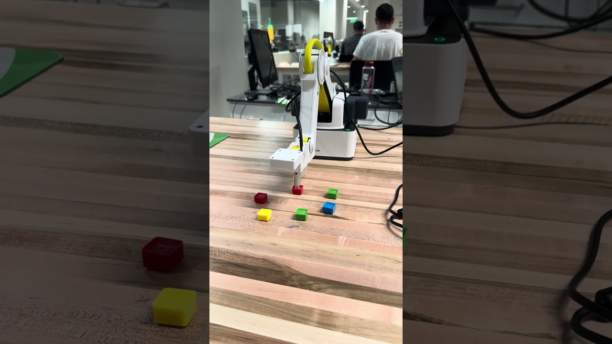
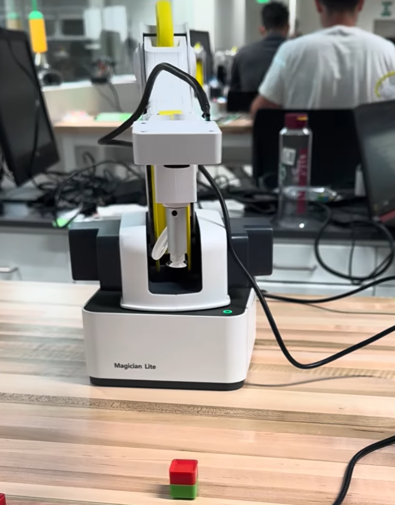
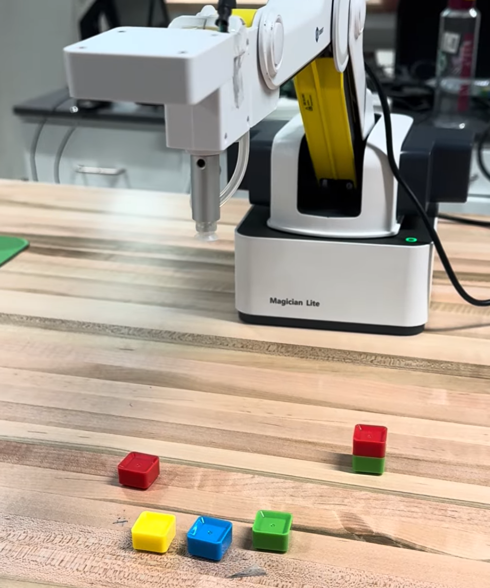
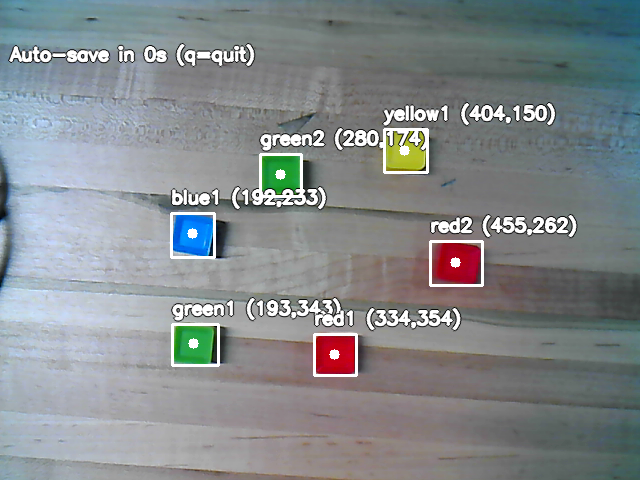

# LLM-Guided Robotic Pick-and-Place

A Dobot Magician Lite that turns natural-language spatial commands ("place red1 on top of green1") into physical pick-and-place actions: OpenCV builds a labelled scene, Gemini chooses tool calls, and calibrated Python geometry drives the arm.

**Python · OpenCV · Gemini 2.5 Flash · Function Calling · Dobot Magician Lite**

## Demo

[](https://youtube.com/shorts/D0o-AyYaEWk)

Jump to: [Scene understanding (0:11)](https://www.youtube.com/watch?v=D0o-AyYaEWk&t=11s) · [Stack red1 on green1 (0:49)](https://www.youtube.com/watch?v=D0o-AyYaEWk&t=49s) · [Place blue1 right of yellow1 (1:19)](https://www.youtube.com/watch?v=D0o-AyYaEWk&t=79s)

## How It Works

```
 "Place red1 on top of green1"
              │
              ▼
   Gemini 2.5 Flash  ──  system prompt + registered robot tools
     │  tool call                                ▲  JSON result
     ├─► capture_scene_with_detection ───────────┤
     │     home arm → camera → HSV masks →       │  [{label, x, y}, …]
     │     contours → centroids → "red1", …      │
     │                                           │
     └─► pick_and_place_block(red1, green1, on_top)
           pixel → robot affine → Z / offset math → fixed waypoints
                         │  pydobot (USB serial)
                         ▼
              Dobot Magician Lite + suction cup
```

**1. Perceive.** The arm returns to a fixed home pose. It carries the camera on its end-effector, so this keeps the view consistent with calibration. OpenCV then segments the blocks by color and saves a labelled scene: `blue1`, `green1`, `green2`, `red1`, `red2`, `yellow1`.

**2. Understand.** Gemini receives the user's command and the scene as structured JSON (labels plus pixel centroids). It never sees the image. It resolves which block to move, which block is the reference, and what spatial relation is meant. If something is missing, it asks a clarifying question instead of guessing.

**3. Plan.** Gemini picks a registered Python function and fills in its arguments, for example `pick_and_place_block(source_label="red1", target_label="green1", placement_type="on_top")`. Plain Python, not the LLM, computes all coordinates, heights and offsets.

**4. Execute.** The tool runs a fixed waypoint sequence on the Dobot over USB and returns a step-by-step result to Gemini. Gemini then confirms the outcome to the user in plain language.

## Example Tasks

These are from the demo video and the [project report](docs/RAS545_Project2_Report.pdf).

**"Understand the scene"**
Gemini calls `capture_scene_with_detection`, which homes the arm, detects six blocks, and saves the annotated frame and JSON. Gemini then summarizes which blocks are where.

**"Place red1 on top of green1"**
Gemini calls `pick_and_place_block(red1, green1, on_top)`. The tool lifts red1 from table height and releases it two block heights plus a 5 mm clearance above the table, directly over green1's centroid.

**"Place blue1 to the right of yellow1"**
Gemini calls `pick_and_place_block(blue1, yellow1, beside, right)`. The tool converts yellow1's position to robot coordinates, offsets it by one block length plus a 10 mm gap along the robot's +Y axis, and places blue1 on the table there.

| Stacking (red1 on green1) | Side placement (blue1 right of yellow1) |
|---|---|
|  |  |

## Vision & Scene Understanding



HSV color ranges (blue, green, yellow, and red, which takes two hue bands) → morphological open/close → external contours → area filter (> 500 px²) → centroid from image moments → per-color instance label → `captures/capture_scene.json`:

```json
[{"label": "blue1", "x": 192, "y": 233}, {"label": "green1", "x": 193, "y": 343}, …]
```

The HSV thresholds were re-tuned for the lab's lighting and wooden table: blue was narrowed to cut false positives, and yellow was widened to catch pale blocks.

## Coordinate Mapping & Manipulation

- **Pixel → robot:** a 2×3 affine matrix computed by jogging the arm to known points and recording pixel/pose pairs, applied as `[X, Y] = M · [u, v, 1]`. It is stored in `config.py`.
- **Heights:** pick at `z_table + block_height`. Stack at `z_table + 2·block_height + clearance`. Travel at a safe Z of 100 mm.
- **Sequence:** home → above source → descend → suction on → lift → above target → descend → suction off → lift.

How each spatial relation is computed:

| Relation | How the target is computed |
|---|---|
| on top | Target block's centroid, raised Z |
| left / right | Target position in robot frame ∓/± 30 mm along Y |
| front / behind | Target position in robot frame ± / ∓ 30 mm along X |

Directions are defined in the robot's base frame (front = +X, right = +Y), not relative to the camera image.

## LLM Tool Calling

The responsibilities are split deliberately:

| Layer | Responsibility |
|---|---|
| **OpenCV** | Perception: block detection, labels, pixel centroids |
| **Gemini** | Language understanding, choosing tools and arguments (`source`, `target`, `on_top`/`beside`, `direction`), clarifying questions, reporting results |
| **Python tools** | Calibration, coordinate transforms, heights, offsets, waypoint sequence, input validation |
| **Dobot** | Physical execution |

The main loop keeps the full conversation history. Each user turn allows up to 20 model ↔ tool round-trips: every function call Gemini makes is executed and its result sent back, until Gemini replies with text only. The system prompt has four rules: Gemini acts as a planner; it must use tools rather than claim an action happened; it asks for missing information; and it summarizes detections after each capture. If a tool rejects a label, the error lists `available_labels`, so Gemini can correct itself.

Registered tools fall into three groups:
- **Perception:** `capture_scene_with_detection`
- **Manipulation:** `pick_and_place_block`
- **Low-level motion and state:** home, move to pose or pixel, suction on/off, read pose, set affine matrix, update scene memory

## Results

The following were demonstrated on hardware in a six-block scene (1 blue, 2 green, 2 red, 1 yellow), as recorded in the [demo video](https://youtube.com/shorts/D0o-AyYaEWk) and [report](docs/RAS545_Project2_Report.pdf):

- **Scene understanding:** all six blocks detected and correctly labelled.
- **Stacking:** red1 placed on green1 without collision or slipping.
- **Spatial placement:** blue1 placed to the right of yellow1.

Front, behind and left placements are implemented through the same `beside` tool but weren't part of the recorded test runs.

Results are task completions. No quantitative accuracy measurements were taken.

## Challenges

- **Calibration drift.** Placements were consistently offset. The cause was a shift in the camera mount angle since the original calibration. The fix was to recalibrate: jog the arm to several points, record pixel coordinates against robot poses, and recompute the affine matrix.
- **Workspace geometry.** The table contact height had to be found by jogging the end-effector down until it touched, and the block dimensions had to be measured. Pick, stack and release heights depend on both.
- **Color segmentation under lab lighting.** The default HSV ranges produced false-positive blues and missed pale yellow blocks against the wooden table. The blue and yellow thresholds were re-tuned for the lab.

## Limitations

- After the scene is captured, a person has to close the camera window (`q`) before Gemini continues.
- The scene isn't updated after a move. Capture again before the next command, and note that labels may be renumbered.
- Stacking assumes the target sits on the table, so stacks are at most two blocks high.
- Motion timing uses fixed delays rather than waiting for the robot to confirm each move. The low-level motion tools have no workspace limits.

## Project Structure

| Role | Files |
|---|---|
| LLM / planning | `LLM_ROBOT.py` (entry point, system prompt, tool-calling loop), `call_function.py` (tool registry and dispatch) |
| Perception | `Robot_Tools/Camera_Capture_Tools.py` |
| Manipulation | `Robot_Tools/Pick_Place_Tool.py` |
| Robot control | `Robot_Tools/Robot_Motion_Tools.py` (pydobot wrappers, affine helpers) |
| Configuration | `config.py` (serial port, camera, affine matrix, heights, block dimensions, home pose) |
| Hardware test | `manual_test.py` (capture plus two placements, no LLM) |
| Docs | `docs/RAS545_Project2_Report.pdf`, `docs/images/`, `captures/capture_scene.json` (example scene) |

## Running the Project

**Hardware**
- Dobot Magician Lite with a suction cup, connected over USB
- A USB camera mounted on the end-effector, looking down at the workspace
- Blue, green, yellow and red blocks (about 20 × 20 × 13 mm) on a flat table

**Software**

```bash
python -m venv .venv && source .venv/bin/activate
pip install -r requirements.txt
cp .env.example .env        # then add your GEMINI_API_KEY
```

**Calibration.** Edit `config.py` for your setup: `default_port`, `camera_index`, the affine matrix `M`, `z_table`, the block dimensions and `home_pose`. The values in the repo are for the original lab setup and won't transfer to another one.

**Run**

```bash
python LLM_ROBOT.py "Understand the scene"
# camera window: auto-saves after 10 s, press q to continue
You: Place red1 on top of green1
You: Place blue1 to the right of yellow1
You: quit
```

Add `--verbose` after the first prompt to print token usage. To test the hardware without Gemini, run `python manual_test.py`.

## Attribution

Completed for **RAS 545: Robotics Systems I** at Arizona State University (Spring 2026), building on course-provided starter code (M. Yourdkhani, *Project 2 – LLM Pick and Place*).

The starter supplied:
- the Gemini tool-calling loop and tool schemas
- the block-detection pipeline
- the pydobot motion wrappers
- the placement-geometry framework

I did the following:
- wrote the system prompt
- implemented label lookup and validation in the pick-and-place tool
- re-tuned the HSV detection for the lab environment
- recalibrated the camera-to-robot transform and the workspace heights
- adapted the robot interface to the lab's pydobot version
- added homing before each capture and pick, so the end-effector camera always captures from the calibrated pose
- integrated, tested and demonstrated the system on hardware

Full write-up: [docs/RAS545_Project2_Report.pdf](docs/RAS545_Project2_Report.pdf)
